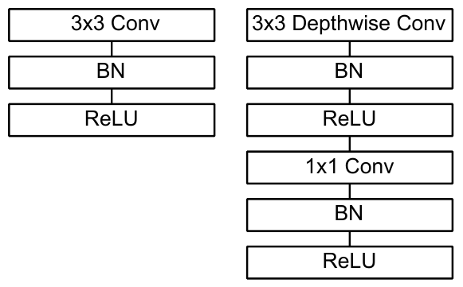

# Architecture 4 MobileNetV1

*Introduction*

MobileNet is a lightweight architecture developed for mobile and embedded devices, where memory and processing power are limited. Its main purpose is to reduce computation while maintaining useful accuracy [4]. This makes it a suitable candidate for our facial recognition system, where both accuracy and processing time matter.

*Depthwise separable convolution*

In a standard convolution, filtering features and combining information from different channels happen together. MobileNet separates these into two operations. Depthwise convolution applies one filter to each input channel. Pointwise convolution then uses 1 × 1 filters to combine these outputs and produce new features [4]. Figure 1 shows how these operations replace a standard convolutional block.

*Figure 1. Standard convolution and depthwise separable convolution. BN denotes batch normalization. Reproduced from Figure 3 of Howard et al. [4].*

For example, consider an input with three channels and a layer that needs 64 output channels. A standard 3 × 3 convolution requires 1,728 weights. Splitting it into depthwise and pointwise operations reduces this to 219 weights, excluding biases and batch normalization. The output can have the same dimensions while requiring much less computation.

*Computational cost and parameters*

Let \(D_K\) be the kernel size, \(D_F\) the feature-map size, and \(M\) and \(N\) the input and output channel counts. Assuming equal input and output spatial dimensions, the computation costs are [4]:

$$
C_{\text{standard}}=D_K^2MND_F^2
$$

$$
C_{\text{separable}}=D_K^2MD_F^2+MND_F^2
$$

For 3 × 3 kernels, the paper reports roughly eight to nine times less computation. The baseline ImageNet model contains 4.2 million parameters and requires 569 million multiply-adds, achieving 70.6% accuracy [4]. These figures describe ImageNet classification, not face verification.

*Core architecture and GEMM*

MobileNet begins with a standard convolution, followed by depthwise and pointwise convolution blocks. Each convolution is followed by batch normalization and ReLU. Average pooling reduces the final feature map, and a fully connected layer followed by softmax produces class probabilities. Counting depthwise and pointwise convolutions separately, the network has 28 layers [4].

Most computation occurs in the 1 × 1 pointwise convolutions. These can directly use general matrix multiplication, or GEMM, without the memory rearrangement often needed for standard convolutions. This allows MobileNet to benefit from optimized matrix-multiplication routines [4].

*Width and resolution multipliers*

The width multiplier reduces the number of channels throughout the network. For example, a multiplier of 0.5 approximately halves the channels, reducing both parameters and computation. However, making the network smaller can also reduce accuracy.

The resolution multiplier reduces the input image size and the spatial size of its feature maps. This lowers computation while keeping the parameter count unchanged at a fixed width. Together, these settings allow the model to be adjusted to the available resources [4].

*Face verification performance*

The original MobileNet paper studies face embeddings but does not report LFW accuracy. For this comparison, we use the MobileNetV1 baseline evaluated by Chen et al. in the MobileFaceNets paper [5].

Their baseline was trained on CASIA-WebFace using ArcFace loss and achieves 98.63% accuracy on LFW, with 3.2 million parameters. Inference takes 60 ms on a Snapdragon 820 CPU using four threads and NCNN [5]. These results belong to the adapted MobileNetV1 baseline, not MobileFaceNet. YTF accuracy and the baseline’s embedding dimension are not explicitly reported.

*Conclusion*

MobileNetV1 provides a practical way to reduce computation through depthwise separable convolutions. Its adjustable width and resolution make it useful when resources are limited. However, its reported accuracy and speed depend on the training setup and hardware. We therefore need to test it on our own dataset and measure the complete processing time before selecting it for real-time facial recognition.

# Conclusion for the main paper

This study compares LightCNN-9, FaceNet, VGGFace and MobileNetV1 for a real-time facial recognition system. Each architecture uses a different approach to learning facial features and managing computational cost. The reported results help identify suitable candidates, but differences in training data, evaluation settings and hardware prevent a direct overall ranking. Our final choice will depend on testing the models under the same conditions using our own dataset. Recognition accuracy, model size and the processing time of the complete system will guide the selection.

# References

[4] A. G. Howard et al., “MobileNets: Efficient Convolutional Neural Networks for Mobile Vision Applications,” arXiv:1704.04861v1, 2017.

[5] S. Chen, Y. Liu, X. Gao, and Z. Han, “MobileFaceNets: Efficient CNNs for Accurate Real-Time Face Verification on Mobile Devices,” arXiv:1804.07573v4, 2018.
